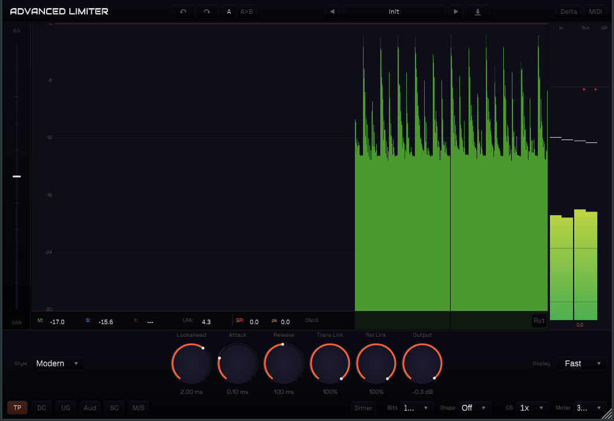

# Advanced Limiter

[](LICENSE)
[](https://github.com/straplocked/advanced-limiter/actions/workflows/build.yml)

A professional brickwall lookahead limiter audio plugin built with [JUCE 7](https://juce.com/). Features 8 limiter styles, true peak detection, stereo channel linking, dithering with noise shaping, oversampling up to 32x, integrated loudness metering (EBU R128), undo/redo, A/B comparison, delta listen mode, MIDI learn, and a real-time scrolling waveform display.



## Features

- **8 Limiter Styles** -- Transparent, Punchy, Dynamic, Allround, Modern, Aggressive, Bus, Safe -- each with distinct lookahead, attack/release scaling, transient preservation, and clipping character
- **True Peak Limiting** with 4x oversampled inter-sample peak detection
- **Lookahead** up to 5 ms with automatic latency compensation
- **Input Gain** vertical fader (-30 to +30 dB) and **Output Level / Ceiling** control (-30 to 0 dB)
- **Stereo Channel Linking** -- independent Transient Link and Release Link (0-100%) for flexible stereo image control
- **Oversampling** -- 1x, 2x, 4x, 8x, 16x, or 32x for reduced aliasing
- **Dithering** with target bit depth (16/18/20/22/24 bit) and 4 noise shaping modes (Off, Basic, Optimized, Weighted)
- **DC Filter** -- 5 Hz high-pass to remove sub-sonic DC offset
- **Loudness Metering** -- Momentary, Short-term, and Integrated LUFS with LRA (Loudness Range) per EBU R128
- **Loudness Target** -- visual indicator for -23, -16, or -14 LUFS targets
- **Real-Time Scrolling Display** with input level, output level, and gain reduction history
- **5 Display Modes** -- SlowDown, Fast, Slow, Infinite, Off
- **6 Meter Scales** -- 16 dB, 32 dB, 48 dB, K-12, K-14, K-20
- **Level Meters** -- 5-bar vertical meter (Input L/R, Output L/R, GR) with peak hold and true peak markers
- **Undo/Redo** with full parameter history
- **A/B Comparison** -- instantly switch between two parameter snapshots
- **Delta Listen** mode -- monitor only what the limiter is removing
- **Unity Gain** mode -- automatic output compensation for level-matched A/B comparison
- **Audition** mode -- hear only the limited/clipped portion of the signal
- **External Sidechain** input for the limiter detection circuit
- **MIDI Learn** -- assign MIDI CC messages to any continuous parameter
- **16 Factory Presets** across Mastering, Mixing, Broadcast, and Creative categories
- **Preset Browser** with search, category filter, and favorites
- **Hover Help** -- hold your cursor over any control for contextual tooltips
- **Pro-L 2 Inspired Layout** -- vertical input gain fader, large primary knobs, compact secondary controls, meters on the right

## Limiter Styles

| Style | Character |
|-------|-----------|
| **Transparent** | Clean, neutral limiting with minimal coloration |
| **Punchy** | Fast attack, transient-preserving with slight clipping |
| **Dynamic** | Program-dependent release for natural dynamics |
| **Allround** | Balanced general-purpose with program-dependent release |
| **Modern** | Short lookahead with moderate clipping |
| **Aggressive** | Very fast, hard clipping for maximum loudness |
| **Bus** | Long lookahead and release for gentle bus limiting |
| **Safe** | Maximum lookahead for ultra-transparent peak control |

## Plugin Formats

| Format | Platform |
|--------|----------|
| VST3 | macOS, Windows, Linux |
| AU | macOS |
| CLAP | macOS, Windows, Linux (requires submodule) |
| Standalone | macOS, Windows, Linux |
| AAX | macOS, Windows (requires SDK) |

## Building

### Requirements

- CMake 3.25+
- C++20 compiler (Clang 14+, GCC 12+, MSVC 2022+)
- JUCE 7.0.12 (included as git submodule)

### macOS

```bash
git clone --recurse-submodules https://github.com/straplocked/advanced-limiter.git
cd advanced-limiter
cmake -B build
cmake --build build
```

Builds universal binary (arm64 + x86_64). Plugins are automatically copied to:
- AU: `~/Library/Audio/Plug-Ins/Components/`
- VST3: `~/Library/Audio/Plug-Ins/VST3/`

### Windows

```bash
cmake -B build -G "Visual Studio 17 2022"
cmake --build build --config Release
```

### Linux

```bash
sudo apt-get install libasound2-dev libfreetype6-dev libx11-dev libxrandr-dev libxcursor-dev libxinerama-dev libgl1-mesa-dev libxcomposite-dev
cmake -B build
cmake --build build
```

### CLAP Support

To build with CLAP format, initialize the submodule:

```bash
git submodule update --init libs/clap-juce-extensions
```

### AAX Support

```bash
cmake -B build -DAAX_SDK_PATH=/path/to/aax-sdk
cmake --build build
```

## Project Structure

```
advanced-limiter/
├── CMakeLists.txt                  Build configuration
├── cmake/PlatformDefaults.cmake    Platform compiler flags
├── JUCE/                           JUCE framework (submodule)
├── libs/clap-juce-extensions/      CLAP support (optional submodule)
├── docs/                           Documentation
├── resources/                      Fonts
└── source/
    ├── PluginProcessor.h/cpp       Audio processor entry point
    ├── PluginEditor.h/cpp          GUI editor
    ├── dsp/                        DSP engine
    │   ├── LimiterEngine           Top-level limiter processor
    │   ├── LimiterCore             Core gain reduction algorithm
    │   ├── LimiterStyle            Style behavior table
    │   ├── TransientStage          Transient detection and linking
    │   ├── ReleaseStage            Release envelope with program-dependent mode
    │   ├── TruePeakLimiter         Inter-sample peak limiter
    │   ├── Oversampler             Up to 32x oversampling
    │   ├── Dithering               Dither and noise shaping
    │   └── DCFilter, SVFFilter     Utility filters
    ├── metering/                   Level, loudness, and true peak metering
    ├── midi/                       MIDI learn manager
    ├── parameters/                 Parameter definitions and layout
    ├── presets/                    Preset system with factory presets
    ├── ui/                        UI components and styling
    │   ├── components/            Panels, knobs, meters, faders
    │   ├── help/                  Hover help overlay and tooltip database
    │   └── LookAndFeel/           Colours, fonts, custom L&F
    └── utils/                     Math utilities and constants
```

## Parameters

23 automatable parameters across 7 groups:

| Group | Parameters |
|-------|-----------|
| **Dynamics** | Input Gain, Output Level, Lookahead, Attack, Release |
| **Style** | Limiter Style (8 choices) |
| **Linking** | Transient Link, Release Link |
| **Detection** | True Peak, DC Filter, External Sidechain |
| **Dither** | Dither On/Off, Dither Bits, Noise Shape |
| **Monitoring** | Unity Gain, Audition, Delta, Display Mode, Meter Scale |
| **Loudness** | Loudness Target, Loudness Time |

## Tech Stack

- **Framework**: JUCE 7.0.12
- **Language**: C++20
- **Build**: CMake 3.25+
- **DSP**: Cytomic TPT SVF filters, one-pole envelope followers, polyphase oversampling
- **Threading**: Lock-free audio thread via atomic parameters and triple buffers

## Contributing

See [CONTRIBUTING.md](CONTRIBUTING.md) for development setup, code style, and contribution guidelines.

## License

This project is licensed under the [GNU General Public License v3.0 or later](LICENSE).
